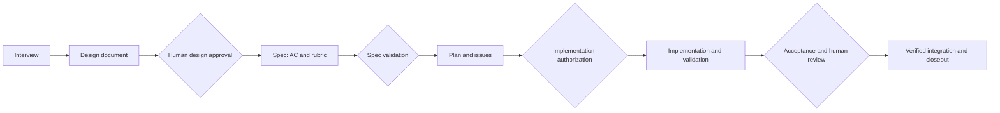
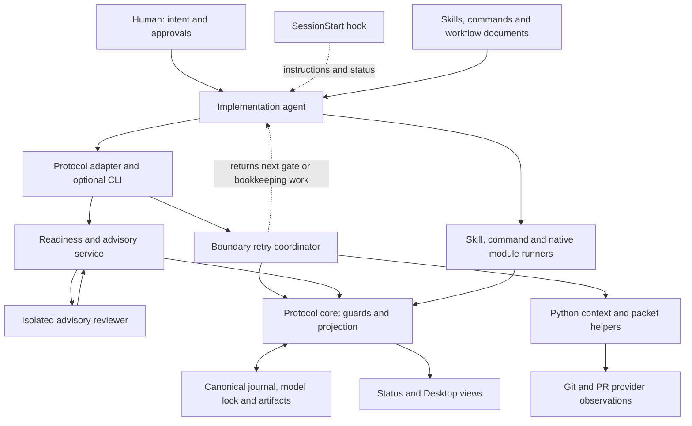
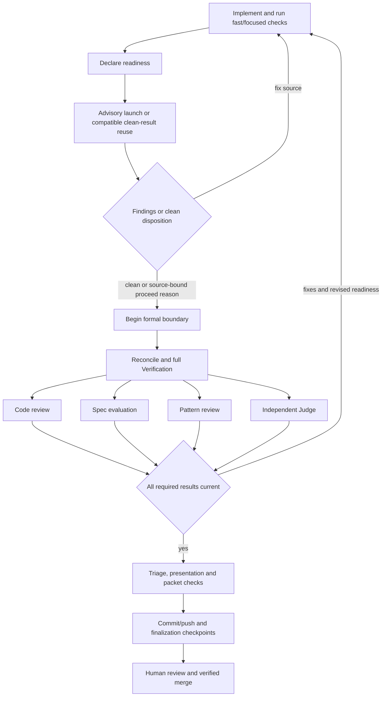
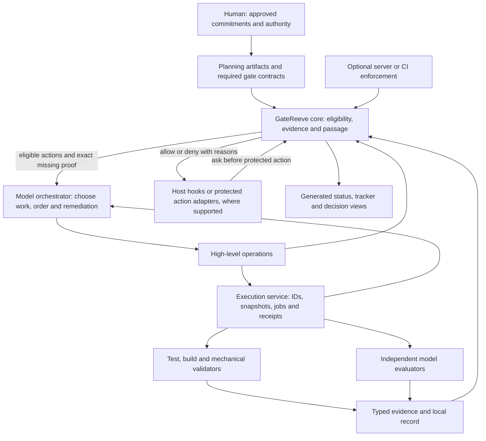

# Architecture discussion - tb-multirepo-review-input

**Status:** interview material; proposed choices are not design approval
**Date:** 2026-10-23
**Record:** [interview.md](interview.md), D1-D4

This document reopens the iteration around model-led orchestration. It retains
the parent-folder storage decision as a component of the architecture. Diagrams
marked current describe inspected rc.16 source at `643e3ea`; proposed diagrams
describe a target for discussion, not installed behavior or confirmed platform
capabilities. No protocol state, implementation or active policy is changed.

## 1. Planning backbone - retained



These are conceptual milestones and approvals, not instructions to create a
separate model session for each box. Interview/design/spec/plan/issues remain
human-readable sources of intent and scope. Tracker and decision records remain
useful views; repeated status/evidence bookkeeping can be generated. Changes to
approved commitments require the applicable authority regardless of how an
orchestrator chooses to execute the work.

## 2. Current component architecture



The model already coordinates substantial work. The problem is how much
mechanical protocol work it must coordinate. The system is not a single rigid
pipeline: its pinned module DAG supports owner-selected ordering. However, the
default review gates depend on full Verification, retry returns one eligible
action at a time, and the agent must bridge skill execution, requests and
bookkeeping checkpoints.

Both source hook manifests and the inspected installed Codex package declare
only `SessionStart`. `session_start.py` injects instructions and a compact
protocol status. This is activation/context, not tool-call interception or an
unbypassable action barrier. The existing core rejects invalid semantic passage;
that does not imply every external edit, shell merge or hosted operation passes
through that core.

## 3. Current delivery flow - default behavior, simplified



The sibling branches show dependency eligibility, not guaranteed concurrent
execution. Gate configuration may change this ordering. Readiness includes
review execution; changing reviewed source requires a new readiness identity.
Evidence-only changes can already preserve some results when reviewed inputs
match. There is no plugin-wide default remediation-round cap.

## 4. Proposed component architecture



The model chooses an adaptive execution plan; GateReeve supplies constrained
operations and evaluates obligations. The execution service owns mechanics,
not a hard-coded universal review sequence. It must reject ineligible execution
before launching a runner, then revalidate inputs/dependencies when accepting
the result. Orchestrators can request a different strategy but cannot change
gate definitions, trust roles or human authority by doing so.

Required gates remain individually identifiable even when a permitted evaluator
can satisfy several obligations. Gate count does not imply session count. An
explicitly independent gate cannot be satisfied by an implementer's own claim.
Real evidence dependencies remain prerequisites; incidental scheduling preferences
become guidance. An assessment that must consume final verification still waits
for it, while early diagnostic review need not.

## 5. Proposed gate fulfillment and enforcement

```mermaid
sequenceDiagram
  actor Human
  participant Model as Orchestrator
  participant Core as GateReeve core
  participant Run as Execution service
  participant Eval as Required evaluator
  participant Hook as Supported action hook
  Model->>Core: Inspect obligations and eligible work
  Core-->>Model: Required gates and missing evidence
  Model->>Run: Request chosen validation on candidate
  Run->>Core: Preflight gate contract and input binding
  Core-->>Run: Eligible execution context or blocker
  Run->>Eval: Execute with pinned inputs
  Eval-->>Run: Outcome, evidence and provenance
  Run->>Core: Submit bound result for acceptance
  Core-->>Model: Accepted/current or rejected/stale
  opt Action requires human approval
    Human->>Core: Confirm the exact candidate and action
  end
  Model->>Hook: Request protected milestone action
  Hook->>Core: Check current gates and required approval
  alt Proof or authorization missing or stale
    Core-->>Hook: Deny with exact missing obligations
    Hook-->>Model: Block action; other authorized work remains available
  else Required proof current
    Core-->>Hook: Allow after validating action, inputs and approval
    Hook-->>Model: Proceed through protected adapter
  end
```

Automatic milestones omit the optional human message; human-required actions
must not be shown as executable until confirmation is current. Authorization
and currentness must bind to the
actual action/candidate; a stale check is not a reusable general permission.

There are three different meanings of gate satisfaction:

| Concern | Owner | What the system can establish |
| --- | --- | --- |
| What must be true | Approved policy/spec and authorized human | Obligations and permitted exceptions are explicit |
| How to demonstrate it | Orchestrator within the gate's permitted methods | Useful strategy can adapt without dropping the obligation |
| Test/build fact | Actual runner and its defined evaluator | Command, inputs, result and applicable evidence are retained |
| Semantic judgment | The evaluator role required by policy | The required assessment occurred against bound inputs; correctness still involves model/human judgment |
| Independent assessment | Separate permitted evaluator/context | Implementer cannot replace it with its own verdict |
| Passage | Deterministic core | Required accepted evidence is current and required authorization exists |

The core cannot prove arbitrary program correctness by checking JSON or hashes.
That is why gate definitions need explicit evaluators and evidence expectations.
Likewise, a `human-confirmed` actor label is the current cooperative record of
observed confirmation, not independent authentication. This iteration must not
claim stronger identity/security guarantees without adding an actual mechanism.

## 6. Hook enforcement boundaries

Settled in interview D5: enforce at protected milestone/action boundaries;
keep authorized intermediate edits, diagnostics and remediation flexible.

- Protected milestones are beginning implementation, entering human acceptance,
  merging and declaring feature completion. Each checks its applicable gates and
  authority. Individual commits do not require these milestone checks.
- Hooks ask the same core that adapters and status use. They do not duplicate
  gate logic or interpret Markdown as a second authority.
- Deny an action requiring a gate when its proof is absent/stale. If the check
  is unavailable, the protected action is unavailable; observation, design
  conversation, cancellation and unrelated authorized work remain usable.
- Do not apply a blanket stop-hook refusal to ordinary conversation or make a
  failing validation prevent the edits needed to repair it.
- Host hook capability is platform-dependent and unimplemented here. Publish
  which actions are intercepted, cooperative only, or externally protected.
  Unsupported interception must not be advertised as enforced.
- Hooks are not an OS sandbox. Arbitrary shell commands, other clients and
  hosted merges may bypass a local hook. Strong external action enforcement
  requires a protected adapter or independently configured server controls.
  Git branch protection/CI is an optional deployment integration, not something
  these diagrams imply has been enabled.
- Preserve truthful reporting of external merges separately from quality
  acceptance. An authorized exception records residuals, not fabricated PASS.

## 7. Input and evidence storage

Keep one canonical parent-folder record with Git tracking optional. Use the
same retained-input/typed-evidence primitives for all relevant gates. Pin
application source separately; bind approved requirements, check inputs,
environment and results. Local retention is not external backup.

The [previous storage proposal](storage-proposal-historical.md) contains capture, publication,
currentness and cleanup analysis to reuse selectively. Avoid introducing an
independent storage protocol for each gate. Models may propose evidence reuse;
the accepted applicability rules must justify it. When applicability cannot be
established, rerun the required check rather than accept an unsupported claim.

## 8. Remaining decisions - discuss in this order

| Decision | Recommendation for discussion | Still to settle |
| --- | --- | --- |
| 1. Hard enforcement boundaries | Settled D5: authorization, human acceptance, merge and completion; no individual-commit gating | Host interception coverage remains to be established during implementation |
| 2. Gate contracts and evaluator authority | Settled D6: independent of implementer; one fresh evaluator may give separate code/spec verdicts | Detailed per-gate proof contracts remain specification work |
| 3. Evidence applicability | Settled D7: targeted delta assessments may supplement earlier proof and must cover changed code/interactions | Detailed manifests and conservative applicability defaults remain specification work |
| 4. Review knowledge and convergence | Settled D8: bounded prior-review knowledge, verified dispositions and unrestricted evidence-backed discovery within gate criteria | Versioned reviewer-input contract and coverage records remain specification work |
| 5. Human exceptions and amendments | Settled D9: scoped human waivers/amendments, truthful outcomes and one observed authorization | Detailed exception policy and provenance schema remain specification work |
| 6. Migration and proof of improvement | Settled D10: direct cutover, no backward compatibility; iterate on real projects | Current-protocol resume details and ordinary regression coverage belong to specification |

All six decision topics now have settled principles. D10 supersedes the
earlier staged migration and compatibility proposals. Separate gate
obligations survive shared evaluation; no validator removal is implied.

### Current discussion: state guidance and removing scheduling machinery

The state machine supplies visible obligations and deterministic refusal of
invalid protocol passage. It does not establish that a model will remember every
obligation or that an external action went through GateReeve. Hooks/protected
adapters extend enforcement at the supported action boundaries. Do not present
model reluctance as a hard guarantee.

Recommendation, not yet ratified: remove plugin `before`/`after` scheduling
preferences and replace the general inter-gate dependency machinery where
possible with each gate's required input-evidence contract. The model chooses
execution order and parallelism. A result requiring Verification must actually
reference applicable Verification; an early discovery review may run without
it. A new explicit gate-to-gate ordering rule is unnecessary when validated
input requirements already express the obligation. This remains a semantic
data dependency, not a claim that all checks can run with arbitrary inputs.

### Current discussion: evaluator independence

Proposed division, pending the user's decision:

| Obligation | Required evaluator character |
| --- | --- |
| Build, lint, tests, schema and packet checks | Defined executable/validator and authentic bound execution evidence; no separate LLM needed merely to read a successful log |
| Code correctness and rubric/spec acceptance | Fresh assessment independent of the implementer's conversation; separate explicit verdicts for separate obligations |
| Semantic pattern checks | May be evaluated by a qualifying independent reviewer; mechanical rules stay executable |
| Tracker reconciliation, formatting and decision bookkeeping | Deterministic checks/generated views; semantic scope or authority judgments remain explicit |
| Design/implementation authorization, human acceptance and exceptions | Human confirmation under the applicable policy; model verdicts cannot replace it |

Settled D6: independence from the implementer is required; code review and spec
assessment need not also be independent of each other. One fresh evaluator may
satisfy both with separate verdicts/evidence. The earlier recommendation is now
a design decision, not an implemented change. Access to prior review knowledge
and current formal history-exclusion changes remain to be decided and versioned.

### Evidence applicability and reuse - targeted refresh accepted in D7

Recommended default: reuse a result when its required inputs remain equivalent
and its retained evidence and evaluator/execution satisfy current policy. Do
not equate a new commit, attempt or timestamp with changed validation inputs.
Record the original evaluated candidate and a separately verified applicability
binding to the current candidate; never rewrite historical run provenance.

| Situation | Proposed treatment |
| --- | --- |
| Only unrelated bookkeeping changed; required inputs match | Reuse after integrity/applicability checks |
| Source/tests, command or relevant environment changed | Refresh affected checks; shared inputs can widen the affected scope |
| Approved requirement/rubric or review base changed | Refresh affected semantic assessments even if code is unchanged |
| Input coverage or equivalence is uncertain | Obtain fresh proof; do not accept an unsupported reuse claim |
| Required artifact missing or altered | Unavailable current proof until exact restoration/revalidation or new evidence |
| External state or an explicit validity window changed | Revalidate under that check's external-state/time contract |

The model proposes an efficient mix of reused and refreshed proof. The core
checks input/evidence contracts; semantic extension to changed code requires
the permitted evaluator, not merely an implementer's opinion. Refresh may be
a focused command or independent delta assessment that complements prior proof
and explicitly covers the new candidate. The later review-knowledge decision
must define any prior-finding access needed for that assessment.

Use conservative input scopes and existing project/build manifests first.
Avoid adding a new dependency-inference subsystem to GateReeve. A changed
shared helper, dependency, migration, fixture or runner is not unrelated merely
because the immediately named endpoint did not change. Missing precise scope
information widens required revalidation.

Final acceptance requires applicable evidence for every required gate on the
final candidate. There is no automatic FAIL-to-PASS reuse, no universal age
expiry and no unconditional full-suite rerun on an identical content snapshot.
Current event-ID dependency coupling remains active until a versioned change
deliberately replaces it; this discussion does not permit replaying an existing
run against replacement dependencies under the old protocol.

D7 explicitly permits an independent delta assessment to supplement earlier
review proof while covering the changed code and its interactions. A new
candidate alone does not demand an entirely new full-slice review. Preserve
original provenance and widen assessment if the change/coverage requires it.

### Prior findings without discovery suppression - accepted in D8

Settled D8: give the fresh evaluator bounded reviewer history from the
outset, with approved requirements, prior source identity and review scope/
limitations, open/resolved findings, claimed dispositions, the current delta
and relevant evidence. Label implementer claims separately from reviewer facts.
Do not provide raw implementation conversation as authoritative context.

The reviewer reports two distinct results within the same evaluation: verified
dispositions of prior findings, and newly supported defects in changed code or
its interactions. This does not prescribe two sessions or a mandatory blind
full review. State uncovered scope and uncertainty so later reuse cannot assume
the earlier assessment covered more than it did.

Focus disposition checks on open findings, claimed fixes and prior resolutions
affected by the delta. Carry unaffected resolutions forward through verified
applicability, with original reports available for inspection; do not require
every historical finding ID to be resubmitted/reconciled on every new round.

Stable finding and defect-class identities prevent rediscovery from appearing
as unrelated findings. A supposedly resolved class can still have another
instance; it remains reportable with concrete evidence. Reopening needs current
contrary evidence, not only a different summary. Reviewers are not instructed
to avoid new defects merely to make the process converge.

Apply the approved gate's blocking criteria, not an automatic rule that every
comment fails the slice. Distinguish actionable in-scope defects from advice,
unsupported concerns and unrelated pre-existing problems. Record relevant
follow-ups without silently expanding approved requirements. Any exceptions or
accepted risks will use the separately discussed human-authority contract.

This proposes a deliberate change to current formal history exclusion. Reviewer
independence means independence from the implementer; receiving a source-bound
earlier review does not imply inheriting its verdict. Any implementation must
version the new input contract and preserve the old record's historical meaning.

### Human exceptions and amendments - accepted in D9

Settled D9: one semantic human decision, applied/recorded by GateReeve,
with transparent consequences rather than repeated proposal/approval/apply/
validate requests to the human. Retain any internal validation/transaction work
necessary for correctness and interruption recovery; do not expose it as four
independent approvals. This is a proposed replacement for parts of the current
change lifecycle, not permission to use unsupported transitions today.

| Decision class | Proposed authority and outcome |
| --- | --- |
| Scheduling, splitting work, changing implementation strategy within approved scope | Model autonomy; update useful planning views without a new human gate |
| Skipping a waivable validation or accepting named unresolved findings | Explicit scoped human risk decision; retain original result and exception, never fabricate PASS |
| Deferring/changing promised behavior or acceptance criteria | Explicit human amendment; preserve old/new requirements and reevaluate affected proof |
| Falsifying execution, evidence identity, actual integration or human confirmation | Not a waiver; retain facts and report the missing/unverified obligation |

Each gate declares its exception policy. Recommend allowing specific human
quality/risk exceptions while preserving evidence-integrity and authority
invariants. A non-waivable gate cannot be bypassed by asserting its guard;
changing that policy requires an explicit policy decision and its own record.
External branch/server protections remain independently enforced.

A compact decision record binds the decision kind, named gates/findings or
old/new requirement versions, applicable candidate/content identity, reason/
known consequences, authorized actions and the observed human instruction.
Retain the quote and conversation/message provenance when the host provides it;
use honest available provenance when it does not. An unambiguous 'yes' to a
concrete presented decision is sufficient. Actor labels are cooperative records,
not external authentication, and an assistant-authored rationale is not silently
quoted as the user's own words.

Default to the specified candidate/risk. Relevant changes require renewed
applicability/authorization; bookkeeping-only changes do not. Standing exceptions
need explicit scope. One instruction may cover several exceptions and merge if
it explicitly does so. Waiving a test alone does not authorize merge/deploy.
Record externally observed merges separately from quality acceptance so human
overrides do not force abandonment of the slice or relabel a failed assessment.

The ordinary milestone outcome must make accepted exceptions visible. Automated
evidence correctness and currentness still apply to all remaining obligations;
an incomplete or interrupted application of the decision is not a completed
milestone. Persist/reconcile idempotently without asking the user to repeat an
already observed authorization.

### Direct cutover and real-project evaluation - accepted in D10

Replace the old orchestration directly. No legacy execution/replay support,
automatic migration system, opt-in pilot, comparative benchmark prerequisite or
fixed percentage target. Trent will resume older work as needed. Existing files
remain context; prior events are not silently reinterpreted as current passage.
The new protocol should establish current obligations/evidence when resuming,
without requiring a fresh planning interview for unchanged commitments.

Keep ordinary implementation regression tests and the required project gates.
Use real work to observe repeated checks, cost/time where available, human
interruptions, meaningful findings, escaped defects and rework. Iterate on
concrete failures without adding a permanent evaluation ceremony. The consolidated
[design](design.md) governs this proposal; earlier compatibility discussion is
historical and superseded.

## 9. Source anchors and verification limits

Current architecture was checked against:

- `plugin-src/codex/hooks/hooks.json` and `plugin-src/claude/hooks/hooks.json`:
  SessionStart only; installed Codex manifest agrees.
- `plugin-src/shared/resources/scripts/session_start.py`: instruction/status
  injection, not a pre-action blocker.
- `plugin-src/shared/resources/protocol/model/workflow-model.json`: planning
  states, gate contracts, default dependencies and ordinary merge transition.
- `plugin-src/shared/resources/protocol/advisory.js`: readiness launch/reuse and
  source-bound proceed rules.
- `plugin-src/shared/resources/protocol/boundary-retry.js`: eligible action
  preparation, core recording, packet/finalization checkpoints.
- `plugin-src/shared/resources/protocol/agent-workflow-scheduler.js`: independent
  native execution and outcome revalidation.
- `plugin-src/shared/resources/protocol/guards.js` and `boundary.js`: accepted
  evidence, trusted guards and passage.
- `docs/WORKFLOW-MODULES.md`: current skill/manual/command adapter and consent
  boundaries; command consent is not a sandbox.

This is source inspection, not a host-hook capability test, live independent
review, performance benchmark or implemented migration. Formal source model
dependencies remain authoritative until an approved change is implemented and
adopted. The preserved feature remains DESIGNING; no gate passage is inferred.
