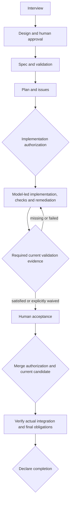
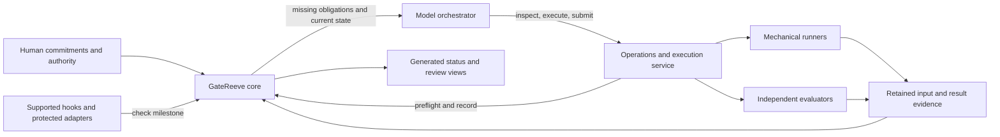

# Design - tb-multirepo-review-input

**Status:** approved (gate passed 2026-10-23)
**Updated:** 2026-10-23
**Controlling interview:** [interview.md](interview.md), D1-D10

## Problem

GateReeve's useful planning and validation obligations have accumulated costly
execution choreography. Readiness can force a reviewer launch, overlapping
assessments repeat work, incidental ordering couples otherwise reusable evidence,
and bookkeeping requires excessive intermediate operations. Models need freedom
to choose an effective execution strategy while the core preserves commitments,
required evidence and human authority.

The originating CareNav failure also exposed a storage mismatch: GateReeve
supports a canonical feature record above nested application repositories, but
compact review and evidence finalization assume that requirements and evidence
are tracked inside the selected application repository. This blocks a valid
parent-folder layout before review can run.

## Intent

Preserve interview, design, specification, plan and issues as the planning
backbone. Preserve required validation gates and enforce them at milestone
boundaries. Let models choose work, diagnostics, order, batching and remediation
inside an authorized phase. Make evidence reusable when it remains applicable,
and let independent reviewers assess targeted changes and their interactions.

Use one canonical local feature record with optional Git tracking. Replace the
old orchestration directly; improve the new approach through real project use.

## Chosen shape

### Planning and milestones

Individual edits and commits do not require milestone passage. The model may
revise execution strategy and task breakdown within approved commitments.
Changes to promised behavior or acceptance criteria require an explicit human
amendment. Required final verification remains distinct from per-slice review.
There is no fixed remediation-round limit; failures call for diagnosis, changed
approach and focused regression evidence. Explicit project stop decisions apply.

### Core, orchestration and execution

The core owns obligations, input/evidence validation, authority and recorded
passage. The model chooses how to satisfy them. The execution service handles
snapshots, jobs, receipts and repeat-safe publication. It does not impose a
universal discovery/fix/judge sequence. Common operations generate structured
records rather than requiring the model to hand-author transport JSON.

Remove incidental plugin `before`/`after` scheduling and the general execution
DAG where gate input contracts suffice. Genuine evidence requirements remain:
an assessment that consumes verification must receive applicable verification.
Early diagnostics can run independently without claiming final acceptance.

A readiness declaration need not launch a reviewer. Discovery can be requested
when useful; existing applicable results can satisfy formal obligations when
their evaluator, input and proof contracts qualify. Diagnostic work is never
promoted merely by renaming it. Helpers should report exact missing proof and
perform routine bookkeeping without another human approval or model turn.

### Gates, evaluators and enforcement

Each gate declares its obligation, accepted proof, relevant input scope,
evaluator role, applicability rules and exception policy. Required gates remain
individually identifiable. One fresh evaluator independent of the implementer
may fulfill code review and spec acceptance with separate verdicts and evidence.
Mechanical facts require actual runner receipts. Human decisions require an
observed human instruction. Additional required validators remain obligations;
this design does not authorize removing them for convenience.

Enforce beginning implementation, entering human acceptance, merging and
claiming completion through the same core. Hooks and protected adapters query
that core; they do not maintain a second state machine. Bind permission to the
actual action and current candidate. Missing/stale proof blocks the protected
action while leaving corrective work and ordinary conversation available.

Current inspected hooks only inject SessionStart context. Implementation must
establish actual interception support per host and report which boundaries are
hard-enforced or cooperative. Hooks do not provide an OS sandbox, external
branch protection or guaranteed control of arbitrary shell/hosted actions.
Do not advertise enforcement that has not been exercised successfully.

### Canonical storage and retained evidence

Resolve one feature home through the trusted workspace configuration. It may
sit above multiple Git repositories, with or without its own Git repository.
Use the same local evidence contract in single- and multi-repository layouts;
Git tracking is optional, not a separate required execution path.

Application source stays pinned to its selected repository and exact base/head.
Approved requirements are separately bound to retained exact bytes and approval
references. Multi-repository evidence names every source pin it actually covers;
a result from one repository does not certify another or their interactions.

Retain immutable input manifests, requirement copies and required evidence
inside the canonical record, outside disposable evaluator checkouts. Manifests
bind feature/repository identity, source and review scope, approved requirements,
check configuration/environment, evaluator contract and consumed evidence.
Hashes identify bytes; copies retain them. Inputs never reference future outputs.
Results retain their original input identity and actual execution provenance.

Reject arbitrary external paths, traversal, symlink substitution and unsupported
file types. Publish complete verified bundles exclusively; conflicting bytes
cannot overwrite an existing identity. Persist results before recording passage.
Interrupted publication/recording reconciles by operation identity and hashes;
a result file without accepted passage is not a passed gate. Missing required
bytes make current proof unavailable. Restore exact bytes or obtain new proof.

The core validates typed evidence references and their full required closure.
Replace application-Git tracking checks and evidence-commit finalization with
this local contract. Derive review inventories from accepted manifests/results,
not caller-supplied changed-path lists. Preserve application source cleanliness,
PR synchronization and reviewed-content checks; local bookkeeping cannot hide
code changes. Requirements and runtime-state changes are not bookkeeping.

Independent execution sees pinned source, approved requirements and the allowed
review packet, with read-only isolation and the existing network restrictions.
It receives no writable canonical path or broad export of the feature folder.
Tracked evidence directories must not leak into ordinary source exports.

Retain referenced evidence by default. Local retention does not imply backup.
No new remote, records repository, ignore-policy edit, automatic pruning or
archiving is required. Before deleting a workspace containing required records,
apply the explicit keep/archive/discard decision and verify any preservation.

### Evidence reuse and targeted assessment

Reuse requires intact evidence, equivalent relevant inputs and an evaluator or
execution that still qualifies under current policy. New commit IDs, attempt
IDs, timestamps or unrelated reports do not alone require repeated validation.
Retain original provenance and record applicability to the current candidate.
Never relabel an old run as having executed on new inputs.

Relevant inputs include source/tests and interaction scope, requirements,
review base, commands/configuration/dependencies, environment assumptions and
consumed evidence. Use conservative scopes and existing build manifests; do
not add a whole-program dependency inference engine. Unknown relevance widens
assessment. External-state checks use their own validity rules, not universal
expiry timers.

Changed relevant inputs need refreshed proof. A qualified independent delta
assessment may supplement earlier review if it covers changed code and its
interactions and identifies the prior proof and current candidate. Broader
changes or uncertain coverage require broader validation. Unchanged checks may
be reused; affected checks may be rerun selectively where coverage is justified.
Final acceptance must cover the final candidate under every applicable gate.

### Prior findings and independent discovery

Provide fresh evaluators a bounded, source-bound packet containing approved
criteria, earlier reviewer findings and coverage limits, current changes,
claimed dispositions and relevant evidence. Label implementer assertions as
claims. Raw implementation conversation is not authoritative reviewer context.

Verify open findings, claimed fixes and resolutions affected by the delta.
Carry unaffected closures through applicability checks. Independently examine
changed code and interactions for new defects, including new instances of an
old defect class. Preserve stable identities and original reports without
forcing every historical finding to be reconciled on every round.

Blocking follows approved gate criteria. Advice, unsupported concerns and
unrelated pre-existing defects do not silently expand acceptance scope. Record
relevant follow-ups for disposition. Prior verdicts are inputs, not instructions.
The core checks evidence integrity; semantic correctness remains an evaluator
judgment and cannot be guaranteed by a manifest.

### Human exceptions and amendments

The human may explicitly waive substantive quality obligations under the gate's
exception policy or amend commitments. A non-waivable policy requires an
explicit policy amendment. Preserve failed or unavailable results and show the
accepted exception; never fabricate PASS, test execution, integration or human
authority. External protections remain independently enforced.

Present the concrete scope and known consequences once. Record named gates or
findings, old/new requirements where applicable, candidate/risk identity,
authorized actions, reason and the actual instruction with available provenance.
An unambiguous response to that proposal suffices. Do not invent message IDs or
quote assistant rationale as human speech. The current actor label is a
cooperative record, not independent authentication.

One instruction may authorize several named decisions or include merge when
explicit. Internal record/apply/validate work does not demand repeated approval.
Relevant changes require renewed applicability or authority; bookkeeping does
not. A waiver alone grants no merge/deployment authority. Amendments preserve
old commitments and refresh affected evidence. Ordinary milestone reports show
exceptions. Actual external integration is recorded separately from quality
acceptance so a human override does not force false abandonment or false PASS.

### Direct cutover and resuming work

Ship one current approach. No backward-compatible execution path, old-protocol
replay requirement, automatic migration system, opt-in rollout, staged pilot or
comparative benchmark is required. Version identifiers still identify the
current contract and reject unsupported input; versioning does not promise
compatibility. Historical artifacts remain intact as project context.

Trent will resume older work as needed. The new protocol needs a straightforward
way to establish current commitments and authority from available documents
and observed instructions, identify the current source, and determine missing
proof. Do not replay or translate an old journal into inferred passes. Reuse
old evidence only if it can actually satisfy current contracts; otherwise
refresh affected proof. Do not repeat unchanged planning interviews solely due
to an obsolete runtime format. Specify the new entry operation without building
a legacy state converter or overwriting the old record.

### Validation and learning in real projects

Retain ordinary implementation tests for the core's meaningful failure cases:
stale/changed requirements and source, missing or altered evidence, incorrect
evaluator authority, unapproved milestone actions, exceptions, interrupted
publication, repeat operations and both repository layouts. Exercise actual
hook/adaptor capabilities. These are correctness checks for the software,
not a research prerequisite for adoption.

Evaluate the operating workflow on real code and real projects. Use existing
receipts and records to notice repeated expensive checks, validation cost/time
where available, human interruptions, meaningful findings, escaped defects and
rework. Separate observed facts from estimates, summed runner time from elapsed
time, and exceptions from passed checks. Findings count alone is not quality.

Fix concrete friction and failures as they arise. No 30% target, matched trial
program, extra blind audit gate, rollout dashboard or statistical equivalence
claim is required. The simplified process still has to satisfy its ordinary
project gates; real-world use does not waive them.

## Alternatives considered

- Preserve the old protocol beside the new one or add automatic migration:
  rejected in D10; adds machinery Trent does not need.
- Require a fresh-feature pilot and matched comparative benchmark before
  adoption: rejected in D10 in favor of real-project iteration.
- Replace the planning backbone or drop required validators: rejected; these
  are the useful commitments the execution layer serves.
- Replace the old choreography with another fixed review sequence: rejected;
  efficient strategy belongs to the model within explicit obligations.
- Trust model memory alone to enforce milestones: insufficient; use core
  refusal and supported action interception, with honest coverage limits.
- Restart full review after every source change: unnecessary when qualifying
  delta assessment and applicable prior evidence cover the current candidate.
- Forbid new findings to force convergence: rejected; legitimate new defects
  remain reportable under approved criteria.
- Require shared records in Git or retain only hashes: rejected; Git is optional
  and exact local copies are necessary to retain evidence.

## Constraints

- This draft synthesizes D1-D10. It is not recorded design approval, a deployed
  protocol or evidence that the switch has already occurred.
- Keep the existing feature identity and worktree for this work. Implement in
  canonical source and owning helpers/tests; use normal build/install paths,
  not edits to plugin caches or generated files as source.
- Preserve human design/spec authority, independent assessment, truthful
  evidence and application source/PR protections. Prepared PRs remain closed
  until an authorized merge window under Trent's policy.
- Runtime cutover does not authorize application changes, old-record deletion,
  hosted merges, production deployment or public publication by implication.
- The historical [storage proposal](storage-proposal-historical.md) supplies
  analysis, not controlling requirements. Its compatibility, formal-history
  exclusion and dual Git/local path prescriptions are superseded here.

## Open risks

- Model orchestration and scoped assessment can miss interactions. Conservative
  scopes, independent review and fresh proof where coverage is uncertain remain
  essential; real-project outcomes should drive refinements.
- Shared evaluator sessions can correlate mistakes between code/spec verdicts.
  D6 accepts this tradeoff while requiring independence from the implementer.
- Host interception capabilities differ. Establish and expose the exact
  enforcement surface rather than relying on guidance alone.
- Core checks cannot infer every semantic input dependency or authenticate a
  human simply from an actor string. Declare these limits explicitly.
- Direct cutover can expose old-work resumption friction. Resolve it in the
  current protocol without quietly reintroducing a legacy interpreter.
- Local records can be lost or grow large. Preserve the explicit retention
  contract; do not claim remote backup or introduce unrequested cleanup.
- Filesystem/journal publication has crash windows. Specific recovery and
  repeat-safe behavior must be covered by the implementation's tests.

## Changes

- **2026-10-23:** Synthesized the model-led design from completed interview
  D1-D10. Preserved the prior storage proposal separately. Direct cutover and
  real-project evaluation replace the unratified staged migration proposal.
  Design approval remains pending.

- **2026-10-23:** Trent explicitly approved the consolidated design in this
  conversation. Core event `evt-model-led-design-approved-20261023` records
  DESIGN_APPROVED; the feature entered SPECIFYING. Historical statements about
  pending approval above describe the draft before this event. No substantive
  design changes accompanied approval.
